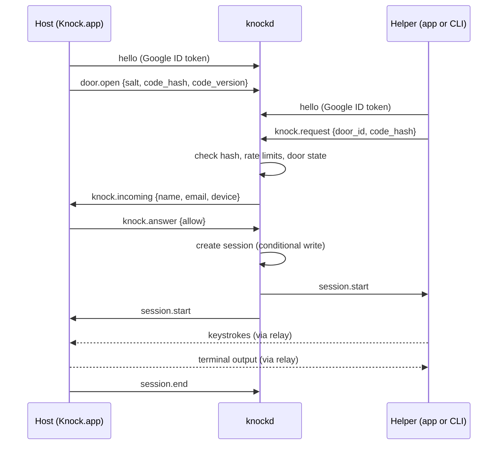

# Knock: design spec

Draft 0.1, 13 November 2026. Status: proposal for review. Items marked **Proposed** are my recommendations, not settled decisions; section 15 lists what is still open.

## 1. What Knock is

Knock lets a colleague share one shell on their Mac with a helper, through our own relay. The host opens the app, the helper knocks, the host lets them in, and both see and type in the same terminal. It is the TeamViewer experience, reduced to a shell.

Three parts:

| Part | What it is | Language |
|---|---|---|
| `Knock.app` | Native macOS app for hosts and helpers. Built first. | Swift, SwiftUI |
| `knock` | CLI for advanced users. Same features, same config, same relay. | Go |
| `knockd` | Relay server. Brokers knocks and forwards session bytes. | Go |

Naming note: a well-known Linux port-knocking tool already ships binaries called `knock` and `knockd`. Inside the cluster, name the image and service `knock-relay` to avoid confusion.

## 2. Rules the product never breaks

1. **Nothing happens without the host.** A session starts only when the host clicks "Let them in" (or types `y`), every time.
2. **App closed means unreachable.** No launch agent, no background daemon. Quitting Knock closes the door.
3. **A code is only the right to knock.** It never grants access on its own.
4. **A new code cuts everyone off.** Old codes, and anything derived from them, stop working at once.
5. **The host sees everything.** Every byte the guest sends is visible in the host's terminal, and the host can end the session at any moment.
6. **The relay never learns the code.** It stores and compares a hash.

## 3. Stack

| Layer | Choice | Why |
|---|---|---|
| Mac app UI | SwiftUI, macOS 27 Liquid Glass, system font | Native glass, sidebar and alert behaviour for free |
| Mac terminal view | SwiftTerm | Terminal emulator view plus local PTY in one package |
| CLI | Go, Charm libraries (Bubble Tea v2, Lip Gloss v2, Bubbles v2) | Single static binary; good TUI pieces |
| CLI PTY | `creack/pty`, `golang.org/x/term` | Standard Go PTY and raw-mode handling |
| Relay | Go, WebSocket (`coder/websocket` or `gorilla/websocket`) | Shares the protocol package with the CLI |
| State | DynamoDB, single table | Conditional writes give race-free coordination across replicas |
| Identity | Google Workspace sign-in (OpenID Connect) | Real names on every knock; domain restriction |
| Runtime | Kubernetes, 2 or more replicas, reachable only on the tailnet | No single point of failure |

**Proposed: Go for both the relay and the CLI.** One language means one shared `protocol` package, so the two cannot drift. Charm, which you mentioned, is Go. Rust would work equally well for the relay (tokio, axum), but it would split the protocol code in two and buys nothing at this scale.

Charm v2 import paths moved to `charm.land/...` (for example `charm.land/bubbletea/v2`). Pin exact versions.

Suggested repository layout:

```
knock/
  protocol/        Go: message types, code hashing, shared by relay and CLI
  relay/           Go: knockd
  cli/             Go: knock
  mac/             Swift: Knock.app (its own Swift copy of the protocol types)
  deploy/          Kubernetes manifests
  docs/            this spec, mocks
```

## 4. Identity

- People sign in with Google or GitHub, brokered by the relay. The operator registers the OAuth apps and gives the relay the client IDs and secrets; clients never hold provider secrets. Setup: `docs/RELAY_SIGN_IN.md`.
- Clients discover providers with `GET /v1/auth/providers` (`{providers, sign_in_required}`), then run the flow: `/v1/auth/{provider}/start` with an S256 PKCE challenge and a `knock://` or loopback redirect, the provider calls the relay back, the relay redirects the client with a one-time grant (2 min, single use), and the client trades grant plus verifier at `POST /v1/auth/token`. The app uses `ASWebAuthenticationSession`; the CLI a loopback listener on 127.0.0.1.
- The relay reads the profile with the provider token and drops it. Optional restrictions are checked there: `KNOCK_GOOGLE_DOMAIN` against Google's `hd` claim, `KNOCK_GITHUB_ORG` against an active org membership. Accounts need a verified email (Google) or come with their GitHub username.
- The relay issues its own HMAC-signed tokens: a 1-hour access token, sent in `hello`, and a 90-day sliding refresh token (`POST /v1/auth/refresh`). Tokens carry the restriction they passed, so changing it, or removing the provider, stops refreshes.
- Anonymous use: allowed when no provider is set (local dev); refused once one is, unless `KNOCK_ALLOW_ANONYMOUS=true`. Refusal is the `anonymous_not_allowed` hello error.
- Tokens live in the macOS Keychain (`docs/LOCAL_STATE.md`), shared by the app and the CLI. When the relay refuses an access token, a client refreshes once, and signs out if that fails too.
- The name, email, GitHub login and provider shown on a knock come from the relay's token, never from text the knocker typed. Anonymous knockers show the name they typed, marked *not verified*.

## 5. Doors, codes and hashes

A **door** is one user on one device (`maya-mbp`). It has a current **code**, shown in the app as `4821 KQ`.

### Code

- Four digits and two letters, generated on the host's device. Letters exclude `I` and `O`.
- Normalised before hashing: upper case, spaces and dashes removed.
- That is about 5.8 million combinations, which is small. Rate limiting (below) is what makes it safe, not the hash.

### Hash

**Proposed:** `code_hash = PBKDF2-HMAC-SHA256(code, salt, 600 000 iterations, 32 bytes)`.

- PBKDF2 is in the standard library on both sides (CommonCrypto in Swift, `crypto/pbkdf2` in Go), so no extra dependency. The record carries a `kdf` field so we can move to Argon2id later.
- The host generates a random 16-byte `salt` with each new code and sends `{salt, code_hash, code_version}` to the relay. The code itself never leaves the device.
- A helper who types a code asks the relay for that door's `salt`, computes the hash locally, and sends the hash with the knock. The relay compares in constant time.
- Everything travels inside TLS. The relay must never log a hash.

What hashing does and does not buy: it keeps codes out of the database, logs and backups. It does not stop a compromised relay from brute-forcing a six-character code offline. The real gates are Google identity and the host's click. A later hardening step is to send an HMAC proof keyed by the hash instead of the hash itself.

### New code

"New code" generates a fresh code, salt and hash and bumps `code_version`. The relay swaps the record atomically (section 8). From that moment every stored hash for that door is wrong.

### Limits

- Five wrong codes per door in ten minutes, and ten per knocker in ten minutes, then a cooldown.
- Twenty wrong codes against one door forces a new code on the host and tells them why.
- A pending knock expires after 60 seconds and counts as "Not now".

## 6. Recent sessions

The helper's main list is **Recent**, not a company-wide directory. It holds doors the helper has already been let into.

- After a successful session the helper's client stores `{door_id, owner name, device, code_version, code_hash, last_session_at}`. The hash goes in the Keychain.
- On launch, and whenever the relay pushes a change, the client sends its stored hashes in `recent.check`. The relay answers per door.
- The relay reveals presence only when the hash matches. Someone holding a stale code cannot even see whether you are online.

| Hash matches | Door state | Row shows | Knock button |
|---|---|---|---|
| Yes | Open | Online | Shown |
| Yes | In a session | In a session, "Busy" | Hidden |
| Yes | App closed or door shut | Offline | Hidden |
| No | Not revealed | Code changed, "Ask for a new code" | Hidden |

- Knocking from Recent sends the stored hash, so no retyping. If the host changed the code a moment earlier, the relay answers `code_mismatch` and the row flips to "Code changed".
- When a host presses "New code", the relay pushes `door.code_changed` to connected clients holding the old hash, so the button disappears live.
- Rows can be removed by hand. Rows that have mismatched for 30 days are pruned.

See `mocks/01-home.png`.

## 7. Flows



- **Open the door:** launch the app (or `knock open`). The client connects outbound to the relay and registers the door.
- **First knock:** the helper enters door and code. On success the door lands in Recent.
- **Knock again:** one click on a Recent row.
- **Accept:** the host's client spawns a PTY running the host's login shell and starts streaming.
- **End:** either side ends it; quitting the host app ends it; the relay ends it if the host's connection drops.

## 8. Relay (`knockd`)

### Responsibilities

Authenticate clients, register doors, validate knocks against the stored hash, deliver knocks, pair the two sides, forward bytes, enforce limits. It holds no shell and runs no commands.

### Wire protocol

One WebSocket per client at `wss://<relay>/v1/ws`. Control messages are JSON text frames; terminal data is binary frames.

| Message | Direction | Purpose |
|---|---|---|
| `hello` | client to relay | ID token, client kind and version |
| `door.open`, `door.close` | host to relay | Register or remove the door |
| `door.code.set` | host to relay | New `{salt, code_hash, code_version}` |
| `door.salt.get` | helper to relay | Fetch the salt for a typed code |
| `recent.check` | helper to relay | Validate stored hashes, get presence |
| `door.code_changed`, `presence.update` | relay to helper | Live updates for Recent |
| `knock.request` | helper to relay | Knock with `code_hash` |
| `knock.incoming` | relay to host | Verified name, email, device |
| `knock.answer` | host to relay | Allow or deny |
| `session.start`, `session.end` | both ways | Lifecycle |
| `session.resize` | host to guest | PTY size changed |
| binary frames | both ways | Terminal output and guest input |
| `relay.draining` | relay to client | Reconnect elsewhere |

Errors: `code_mismatch`, `door_offline`, `door_busy`, `rate_limited`, `denied`, `timeout`, `unauthorised`.

### Running two or more replicas

The host's socket may land on replica A and the helper's on replica B. Two things must hold: state changes are race-free, and the two sockets get joined.

**State lives in DynamoDB, never in one replica's memory.** Every decision that could race is a conditional write.

| Item (PK / SK) | Fields | Notes |
|---|---|---|
| `DOOR#<id>` / `META` | owner, device, `salt`, `code_hash`, `code_version`, `conn_epoch` | One per door |
| `DOOR#<id>` / `CONN` | replica address, `epoch`, state, `expires_at` | Which replica holds the host's socket; heartbeat every 15 s, expires after 45 s |
| `DOOR#<id>` / `SESSION` | session id, guest, started, `expires_at` | At most one per door |
| `KNOCK#<id>` / `META` | door, guest, `code_version`, `expires_at` | Pending knocks, 60 s |
| `RATE#<door or user>` / `WINDOW` | counter, `expires_at` | Atomic `ADD` |

How each race is closed:

| Race | Resolution |
|---|---|
| A door reconnects to another replica while the old socket lingers | `conn_epoch` is incremented atomically on `META`; `CONN` is written only if the new epoch is higher. The old replica's next heartbeat fails its condition and it drops the stale socket. |
| "New code" while a knock is in flight | Accepting is one transaction: check `code_version` equals the knock's, put `SESSION` if absent, set `CONN` to busy if the epoch still matches. If the code changed first, the transaction fails and the helper gets `code_mismatch`. |
| Two helpers knock at once | Both knocks reach the host. The first "Let in" creates `SESSION`; the second fails the "if absent" condition and gets `door_busy`. |
| A replica dies | Its `CONN` rows stop heartbeating and expire. Clients reconnect with backoff to a live replica. |

DynamoDB deletes expired items lazily, so every read also checks `expires_at` itself. Hash checks and accepts use consistent reads.

**Joining the sockets. Proposed: pod-to-pod forwarding.** Each replica registers its pod address in `CONN`. When a knock arrives at replica B for a door held by A, B opens an internal stream to A and proxies the knock and then the session. Internal traffic uses mutual TLS and a NetworkPolicy that only admits relay pods. Alternatives are a pub/sub bus (Redis or NATS), which adds a component, or redirecting the helper to A, which needs per-pod addresses at the ingress.

### Kubernetes

- `Deployment`, `replicas: 2` minimum, spread across nodes and zones, `PodDisruptionBudget` with `minAvailable: 1`.
- Exposed only on the tailnet (Tailscale Kubernetes operator or an internal load balancer). Not on the public internet.
- Ingress and load balancer idle timeouts raised for WebSockets; the relay pings every 20 seconds.
- On `SIGTERM` a replica stops accepting, sends `relay.draining` to idle clients, and waits for live sessions up to the termination grace period before closing them. In v1 a session does not survive its replica; the clients show "Relay restarted, knock again".
- DynamoDB access through the pod's service-account role. On-demand capacity, point-in-time recovery on.
- Metrics: open doors, knocks by outcome, live sessions, forwarded bytes, conditional-write failures.

### Transport security

- v1: TLS from each client to the relay, plus mutual TLS between replicas. The relay could read session bytes in memory.
- **Proposed for the first wide rollout:** end-to-end encryption. After "Let in", the two clients do an X25519 exchange through the relay and encrypt frames with ChaCha20-Poly1305, so the relay forwards ciphertext only. A shared shell carries things like `sudo` passwords, so this is worth doing early.

## 9. Mac app

Start here. Targets macOS 27; uses the system glass materials rather than custom blur, so check API names against the macOS 27 SDK.

### Screens (see `mocks/`)

| Mock | Screen |
|---|---|
| `01-home` | Glass sidebar: "Open to knocks" switch, your code with a refresh button on the same line (click the code to copy), your account. Main area: "Online now" list with presence and a field to search or enter a code. |
| `02-knock-alert` | Knock shown as a glass alert inside the window. |
| `03-knock-notch` | Knock shown dropping from the notch. |
| `04-shared-shell` | The terminal, who is in it, a timer, "End session", a typing indicator. |
| `05-cli` | Both sides of the CLI. |

The mocks are example screens. Names, codes and terminal contents are placeholders.

### Liquid Glass use

Glass goes on the navigation layer only: the sidebar, toolbar capsules, the alert, the notch panel. Lists and anything with body text sit on solid surfaces. The accent is the logo blue, `#0043F3`. Respect "Reduce transparency" and "Increase contrast".

### The notch

A knock should be impossible to miss even when Knock is not the front window, so on Macs with a notch the request drops out of it.

- Detect the notch with `NSScreen.safeAreaInsets.top > 0`; get its rectangle from `auxiliaryTopLeftArea` and `auxiliaryTopRightArea`.
- Show a borderless, non-activating `NSPanel` above the menu bar, on all Spaces and over full-screen apps. It starts at the notch's size and springs open. It is pure black so it merges with the hardware.
- Contents: avatar, "Knock, knock.", verified name and device, "Not now" and "Let Sam in".
- No default button. Return must not let someone in by accident. Escape means "Not now". After 60 seconds it closes as "Not now".
- No notch (external display, older Mac, clamshell): show the same panel as a floating glass capsule at the top centre of the main screen.
- If the Knock window is already frontmost, use the in-window alert instead.
- The panel is the only thing Knock shows on screen uninvited, and only while the app is running with the door open.

### Terminal and what the guest types

- The host's app spawns the PTY and renders it with SwiftTerm. PTY output goes to the local view and to the relay. Guest input arrives from the relay and is written into the PTY, so it echoes exactly like local typing.
- The PTY size follows the host's window. The guest's view letterboxes.
- A typing indicator shows who is typing right now.
- **Keystroke ribbon (Proposed):** a thin strip showing the guest's recent keys, including ones a shell does not echo, such as Control-C, Tab and Return. This is the honest answer to "what did they just press".
- **Hands off:** a toolbar toggle that makes the guest view-only. Use it before typing a password.

### Distribution

- Developer ID signed, notarised, hardened runtime. It cannot be sandboxed because it spawns a shell, so it is not a Mac App Store app.
- Installed to `/Applications` by MDM. The relay address, allowed domain and logging policy come from managed preferences.

## 10. CLI (`knock`)

| Command | What it does |
|---|---|
| `knock login`, `knock logout`, `knock whoami` | Google sign-in, stored in the Keychain |
| `knock open [--tmux]` | Open your door in this terminal and wait for a knock |
| `knock <door> [code]` | Knock. The code is optional when the door is in Recent |
| `knock recent` | List recent doors with presence and whether the code still works |
| `knock new-code` | Replace your code |
| `knock sessions ls`, `knock sessions play <id>` | List and replay saved sessions |
| `knock config` | Show or edit settings |

Terminal handling:

- Menus, the Recent picker and the "Let Sam in?" prompt use Bubble Tea and Lip Gloss.
- **During a session the CLI does not run a TUI over the stream.** It puts the local terminal in raw mode and passes bytes straight through between the terminal, the PTY and the relay.
- The host side reserves the bottom row as a status line, by giving the PTY one row fewer than the terminal and setting a scroll region. It shows who is in, the elapsed time, the typing indicator and the key to end the session.
- `--tmux` attaches the shared PTY to a tmux session named `knock`, for hosts who want panes and scrollback.
- Window resizes on the host are sent as `session.resize`. If the guest's terminal is smaller than the host's, the guest is told.
- The CLI and the app share `~/.knock/` and the Keychain, so a user can switch between them.

## 11. Session logs

Each side can save a recording under `~/.knock/sessions/`.

```
~/.knock/sessions/2026-11-13T17-42-10Z_sam-carter_k7f3/
  meta.json       who, which door, start, end, client versions
  session.cast    terminal output with timings (asciicast, replayable)
  keys.jsonl      optional: guest input, one entry per chunk, with source
```

- Directory mode `0700`, files `0600`.
- `session.cast` replays with `knock sessions play` or any asciicast player.
- **Recording input is off by default.** Input logs capture things that never appear on screen, including passwords typed at a no-echo prompt.
- A session that is being recorded says so to both people in the status line.

## 12. Settings

`~/.knock/config.toml`, overridden by MDM-managed preferences where a key is managed.

| Key | Default | Meaning |
|---|---|---|
| `relay.url` | none, set by MDM | Relay address |
| `auth.domain` | none, set by MDM | Allowed Workspace domain |
| `sessions.save` | `"output"` on the host, `"off"` on the helper | `off`, `output`, or `output+input` |
| `sessions.dir` | `~/.knock/sessions` | Where recordings go; point it elsewhere to keep them on another volume |
| `sessions.retention_days` | `30` | Older recordings are deleted |
| `guest.input` | `"allow"` | `allow` or `view-only` at session start |
| `guest.verified_only` | `false` | Turn away knocks from people who aren't signed in, before the host is asked. It only ever declines |
| `knock.notch` | `true` | Use the notch panel when available |
| `knock.timeout_seconds` | `60` | How long a knock waits |
| `shell.command` | the login shell | What the PTY runs |

## 13. Security summary

- Identity: Google ID token, verified by the relay, restricted to our domain.
- Consent: explicit accept per session; no default button; the app must be running.
- Codes: generated on device, stored and compared as salted hashes, rate-limited, replaceable in one click.
- Presence: revealed only to holders of the current hash.
- Network: relay reachable only on the tailnet; TLS everywhere; mutual TLS between replicas.
- The shell runs as the logged-in user. Knock grants nothing that user does not already have.
- Audit: the relay logs who knocked on which door, the outcome and the duration. It never logs codes, hashes or terminal contents.

## 14. Build order

| Step | Scope | Done when |
|---|---|---|
| 0 | `protocol` package and a single-replica relay with in-memory state | Two test clients can knock, accept and exchange bytes |
| 1 | Mac app: sign-in, home, in-window knock alert, shared shell, new code, copy code | Two Macs complete a session through the relay |
| 2 | Relay on Kubernetes: DynamoDB state, two replicas, pod-to-pod forwarding, draining | Sessions work with host and helper on different replicas; killing a pod loses nothing but its live sessions |
| 3 | Recent list, live code-changed updates, rate limits | The Knock button disappears within a second of "New code" |
| 4 | Notch panel, Hands off, keystroke ribbon, session logs | |
| 5 | CLI with the same features | App and CLI interoperate in all four pairings |
| 6 | End-to-end encryption; wider rollout | |

The Mac app comes first, but it needs something to talk to, which is why step 0 is a minimal relay.

## 15. Open questions

1. End-to-end encryption in step 1 or step 6? It is cheaper to add before there are two client implementations.
2. Should the code stay at six characters, or grow to eight now that Recent removes most retyping?
3. Do hosts want a "recent guests" list, or is one "New code" button enough?
4. Should a session survive a relay restart (resume), or is "knock again" acceptable?
5. Are central session recordings wanted later (for example uploads to object storage), or do recordings stay on the two laptops?
6. DynamoDB assumes the cluster runs on AWS. If it does not, the same conditional-write design maps to Postgres or Redis.
