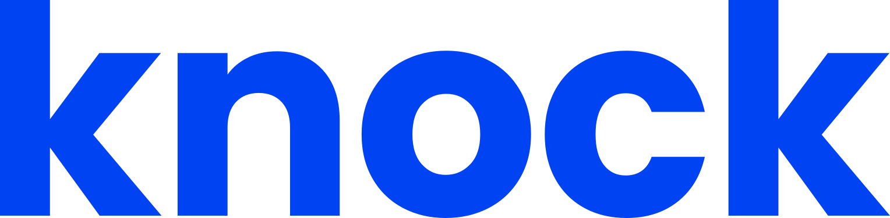
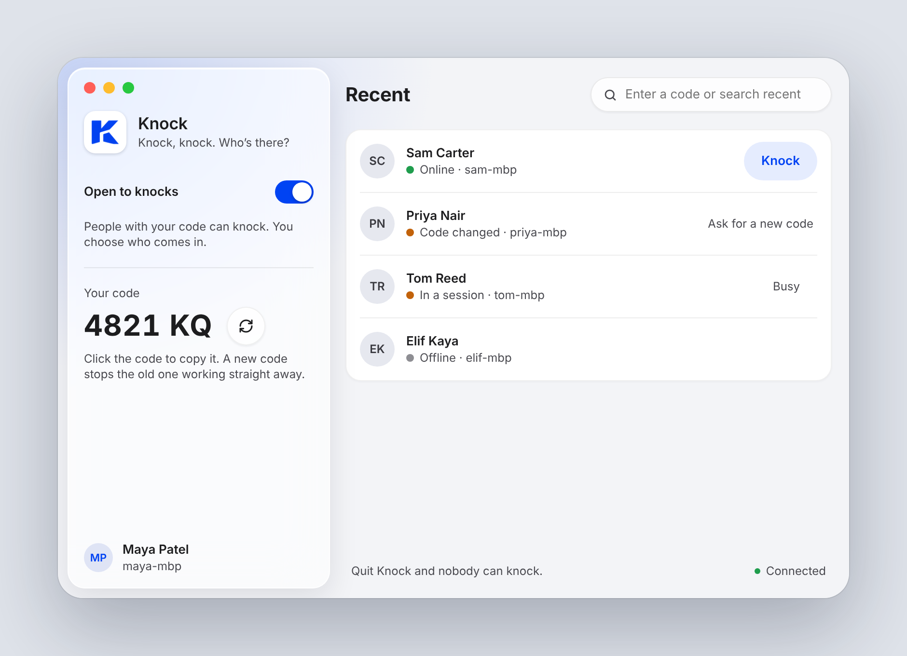
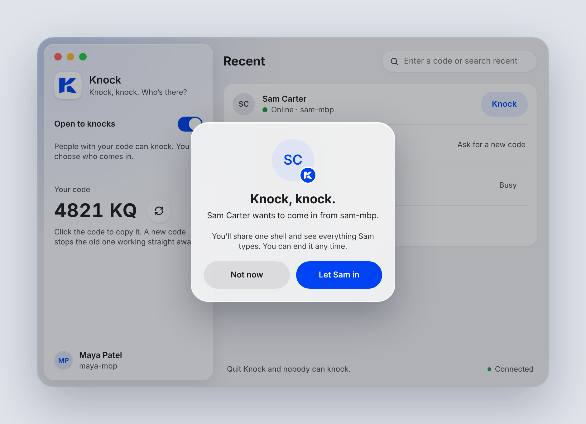
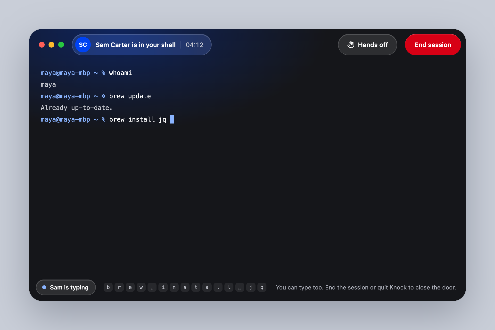
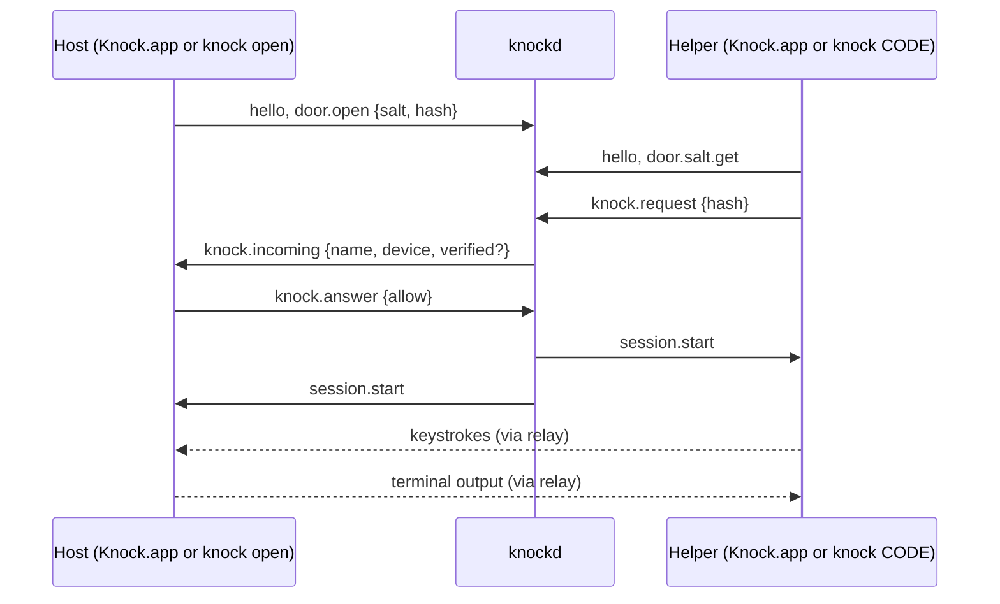

<p align="center">
  
</p>

<h3 align="center">Knock, knock. Who's there?</h3>

<p align="center">
  Share one shell on your Mac with the person helping you.<br>
  They knock, you let them in, you both type in the same terminal.<br>
  <a href="https://idestis.github.io/knock/">idestis.github.io/knock</a>
</p>

<p align="center">
  <a href="https://github.com/idestis/knock/releases/latest"></a>
  <a href="https://github.com/idestis/knock/actions/workflows/ci.yml"></a>
  
  
</p>

> [!WARNING]
> **Knock is in early alpha.** Expect rough edges and breaking changes between releases while bugs are being fixed. Please [open an issue](https://github.com/idestis/knock/issues) if something breaks.

<p align="center">
  
</p>

---

## What

Knock is the TeamViewer experience, reduced to a shell.

- **Knock.app**: a native macOS app with Liquid Glass, a menu bar item, notch alerts and native notifications.
- **`knock`**: a CLI for the terminal crowd. Same features, same relay, and it works with the app in every pairing.
- **`knockd`**: a small relay you run yourself. It passes knocks along and forwards bytes. It never runs a command.

## Why

Pairing on someone else's machine usually means screen sharing a terminal you can't type in, or handing out SSH access you then forget to take back. Knock sits in between:

| | Screen share | SSH access | **Knock** |
|---|---|---|---|
| Helper can type | No | Yes | **Yes** |
| Host sees every key | Yes | No | **Yes** |
| Host approves each visit | n/a | No | **Yes, every time** |
| Access ends when you're done | Yes | Rarely | **Quit and it's gone** |
| Needs open ports or VPN config | No | Often | **No, outbound only** |

Knock follows a few rules it never breaks:

1. **Nothing happens without the host.** A session starts only when the host clicks *Let them in*. There is no default button, so Return never lets anyone in.
2. **App closed means unreachable.** There's no launch agent and no background daemon. Quit Knock and the door is closed.
3. **A code is only the right to knock.** It never grants access on its own.
4. **A new code cuts everyone off,** straight away.
5. **The host sees everything,** including keys the shell doesn't echo, and can make the guest view-only (*Hands off*) or end the session at any moment.
6. **The relay never learns the code.** It stores and compares a salted PBKDF2 hash.

Inspired by [upterm](https://github.com/owenthereal/upterm), built for people who'd rather click than configure.

## How

<p align="center">
  
  
</p>

1. **The host opens Knock.** The app shows one code, like **`BVJY 4821 KQ`**. Click it to copy.
2. **The helper knocks** by pasting the code into Knock, or from a terminal:
   ```sh
   knock BVJY 4821 KQ
   ```
3. **The host gets a knock**: it drops from the notch, shows as a notification with *Let in* and *Not now*, and appears in the window. The knocker's name is verified if they signed in, and clearly marked *not verified* if not.
4. **They share one shell.** It's the host's login shell, in a PTY on the host's Mac. Either side can end it.
5. **Next time it's one click.** People you've been let in by appear in your list with live presence: *Open*, *In a session*, *Door closed* or *Code changed*.



## Install

Homebrew loads third-party taps only once you trust them, so first, once:

```sh
brew tap idestis/tap && brew trust idestis/tap
```

**Mac app** (macOS 26+):

```sh
brew install --cask idestis/tap/knock
```

Or download `Knock-x.y.z.dmg` from [Releases](https://github.com/idestis/knock/releases/latest) and drag Knock to Applications. It's signed, notarized, and updates itself from GitHub Releases either way.

**CLI** (macOS and Linux, arm64 and amd64):

```sh
brew install idestis/tap/knock
```

Use the full name: homebrew/core has an unrelated `knock` (a port-knocking client). Upgrade with `brew upgrade idestis/tap/knock`. The app doesn't bundle the CLI, so you can install both; they share `~/.knock`.

Without Homebrew, grab the tarball for your platform:

```sh
curl -fsSL https://github.com/idestis/knock/releases/latest/download/knock_$(curl -fsSL https://api.github.com/repos/idestis/knock/releases/latest | sed -n 's/.*"tag_name": "v\(.*\)".*/\1/p')_$(uname -s | tr A-Z a-z)_$(uname -m | sed 's/x86_64/amd64/;s/aarch64/arm64/').tar.gz | tar -xz --strip-components=1 -C /usr/local/bin '*/knock'
```

`knock update` keeps a tarball install current; a Homebrew install points you to `brew upgrade`. Then `knock open` to host, or `knock CODE` to knock.

**Relay.** You need one knockd that both sides can reach. See [Run a relay](#run-a-relay).

## Using the CLI

| Command | What it does |
|---|---|
| `knock open [--tmux] [--view-only]` | Open your door in this terminal and wait for a knock |
| `knock close` | Close your door wherever it's open, in the app or another terminal |
| `knock copy` | Copy your code to the clipboard without printing it |
| `knock new-code` | Replace your code. Old codes stop working at once |
| `knock BVJY 4821 KQ` | Knock with someone's code |
| `knock BVJY` | Knock on someone in your list, no code needed |
| `knock recent`, `knock recent rm <door>` | Your list, with presence and whether the code still works |
| `knock login [google\|github]`, `logout`, `whoami` | Optional sign-in, kept in the Keychain |
| `knock sessions ls`, `knock sessions play N` | List and replay recordings (asciicast) |
| `knock config`, `config set <key> <value>`, `config unset <key>` | Show or change settings in `~/.knock/config.toml` |
| `knock update [--check]` | Update knock from GitHub Releases (checksum-verified) |

In a session, press `Ctrl-]` then `q` to end it, or `Ctrl-]` then `h` to toggle *Hands off* (host only).

## Sign-in is optional

Knock works without an account: you knock with a name you type, and hosts see it marked *not verified*. Sign in with **Google** or **GitHub** to put a verified name and email on your knocks. A relay with sign-in set up requires it by default.

Sign-in goes through your relay (OAuth with PKCE), so provider secrets stay on the server. The relay issues its own tokens: a one-hour access token and a 90-day refresh token that renews on every use. Both live in the macOS Keychain, so you stay signed in for as long as you keep using Knock.

## Run a relay

```sh
docker run -p 8787:8787 -e KNOCK_TOKEN_SECRET="$(openssl rand -base64 48)" ghcr.io/idestis/knock-relay:latest
```

Kubernetes: use the Helm chart (preferred). It's published with every release and versioned with it:

```sh
helm install knock-relay oci://ghcr.io/idestis/charts/knock-relay --version 0.1.0 -f values.yaml
```

Values, sign-in, ingress (WebSocket timeouts) and examples are in [`charts/knock-relay`](charts/knock-relay/README.md). A plain manifest with a Tailscale-only service is still in [`deploy/knock-relay.yaml`](deploy/knock-relay.yaml) if you'd rather not use Helm.

Point the app at the relay in **Settings → General → Relay**, or set `relay.url` with MDM or in `~/.knock/config.toml`.

| Variable | Meaning |
|---|---|
| `KNOCK_PUBLIC_URL` | The relay's public URL, used for OAuth callbacks |
| `KNOCK_TOKEN_SECRET` | 32+ random bytes that sign tokens. Keep it stable so sign-ins survive restarts |
| `KNOCK_ALLOW_ANONYMOUS` | Unset: anonymous when no provider is set, sign-in required once one is. `true` keeps anonymous use next to sign-in |
| `KNOCK_GOOGLE_CLIENT_ID`, `_SECRET`, `KNOCK_GOOGLE_DOMAIN` | Google sign-in, optionally limited to one Workspace domain |
| `KNOCK_GITHUB_CLIENT_ID`, `_SECRET`, `KNOCK_GITHUB_ORG` | GitHub sign-in, optionally limited to active members of one org |
| `KNOCK_RELAY_NAME` | Name shown to clients (default `knock-relay`) |
| `KNOCK_KNOCK_TIMEOUT_SECONDS` | How long a knock waits for the host (default 60) |
| `KNOCK_TRUSTED_PROXIES` | CIDRs of proxies whose `X-Forwarded-For` the relay believes, comma-separated. Unset ignores the header. Set it behind an HTTP ingress, or anonymous knockers share the ingress's address for rate limits |
| `KNOCK_DRAIN_GRACE` | On shutdown, how long to wait for live sessions to end (default `25s`) |

OAuth callback URLs to register: `https://<relay>/v1/auth/google/callback` and `https://<relay>/v1/auth/github/callback`. Step-by-step setup for both providers is in [docs/RELAY_SIGN_IN.md](docs/RELAY_SIGN_IN.md).

Run a single replica. Door ownership can be kept in Valkey (`KNOCK_STORE=valkey`) so it survives restarts; sessions and knocks stay in memory. The multi-replica design (pod-to-pod forwarding) is in [DESIGN.md](DESIGN.md#8-relay-knockd).

## Security, in short

- The relay sees knocks, presence and (in v0.1) session bytes in memory. It never stores or logs codes, hashes or terminal contents. End-to-end encryption is planned.
- A 6-character code is small. Rate limits keep guessing impractical: 5 wrong codes per door and 10 per knocker in 10 minutes, and 20 wrong codes force a new code on the host. The real gates are the host's click and, if you require it, sign-in.
- The shell runs as the host. Knock grants nothing that user doesn't already have.
- Recordings stay on the two Macs under `~/.knock/sessions` (`0700`/`0600`). Recording keystrokes is off by default, because it captures passwords typed at no-echo prompts.

## Develop

```sh
brew install go go-task xcodegen create-dmg git-cliff gh
task setup        # check tools
task test         # Go (race) + Swift tests
task dev          # local relay + Debug app
task relay:run    # knockd on 127.0.0.1:8787
task cli:build    # bin/knock
task landing:dev  # the website (Vite + Tailwind), deployed to GitHub Pages from main
```

```
protocol/   Go wire types and code hashing, shared by relay, client and CLI
client/     Go WebSocket client
relay/      knockd (Go)
cli/        knock (Go, Charm v2)
mac/        Knock.app (SwiftUI, SwiftTerm, Sparkle), generated with XcodeGen
charts/     Helm chart for the relay (task chart:lint)
deploy/     Plain Kubernetes manifest
docs/       Local state contract shared by the app and CLI
design/     Logo and mocks
landing/    The website at idestis.github.io/knock
```

**Releasing** (maintainers): `task release:preview`, then `task release` (version from commits, or pin it: `task release -- 0.2.0`), then `task publish`. That builds, signs and notarizes the app and CLI, writes a Sparkle appcast, uploads everything to a GitHub release, and points the [Homebrew tap](https://github.com/idestis/homebrew-tap) (a checkout at `../homebrew-tap`, or `TAP_DIR=`) at the new version. Pushing the tag also publishes the relay image and the Helm chart (GitHub Actions); `task release` keeps `charts/knock-relay/Chart.yaml` on the same version. One-time setup: `task signing:setup`, `task notary:setup`, `task sparkle:keys`.

Read [DESIGN.md](DESIGN.md) for the full spec and [CONTRIBUTING.md](CONTRIBUTING.md) before opening a pull request.

## License

[MIT](LICENSE)
